<p align="center">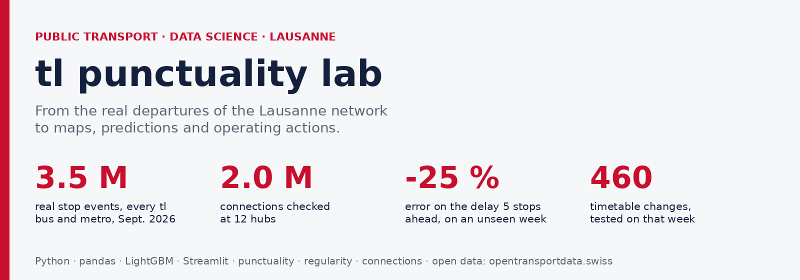</p>

<p align="center">
<a href="https://github.com/kawtar-bellamine/tl-punctuality-lab/actions"></a>


</p>

**Projet de [Abderrahmane BOULAMI](https://github.com/Abderrahmane-BOULAMI) et [Kawtar BELLAMINE](https://github.com/kawtar-bellamine), élèves ingénieurs aux Arts et Métiers ParisTech.**

Les données réelles de **chaque bus et métro tl**, à **chaque arrêt**, sur **tout le mois de septembre 2026**
(3 507 231 passages, 47 lignes, 983 quais), transformées en décisions
d'exploitation :

| | Question | Ce que l'outil livre |
|---|---|---|
| 1 | **Où et quand** la ponctualité se perd-elle ? | indicateurs par ligne, heure, arrêt |
| 2 | **Où sur la carte** le retard se crée-t-il ? | carte des segments qui coûtent le plus de minutes par jour |
| 3 | Les bus fréquents passent-ils **régulièrement** ? | bus en peloton, trous, attente en plus pour les voyageurs |
| 4 | Les **correspondances** sont-elles tenues ? | taux de correspondances manquées par pôle, effet d'une attente courte |
| 5 | Quel retard **annoncer** quelques arrêts plus loin ? | prévision LightGBM et fourchette à 80 %, simulateur |
| 6 | Quels **horaires** ajuster ? | ajustements de temps de parcours, testés sur une semaine inédite |
| 7 | Que faire **sur une ligne** ? | fiche d'actions d'une page par ligne |

## Résultats

| | Résultat |
|---|---|
| Passages mesurés (statut REAL) | 3 393 393 sur 3 507 231 enregistrements (96,9 % mesurés) |
| Ponctualité du réseau | **74,3 %** à l'heure, 19,7 % en retard (≥ 3 min), 5,9 % en avance (> 1 min) |
| Pointe du soir (semaine, 17 h à 19 h) | **27,7 %** des départs en retard |
| Lignes les plus en retard | 64 (37 %), 18 (35 %), 21 (34 %), 1 (34 %) ; métro m1 : 91,2 % à l'heure |
| Où le retard se crée | **10 segments** sur 550 (1,8 %) créent **13 %** du retard ; le premier, St-François → Bel-Air, coûte 446 min par jour de semaine |
| Régularité des lignes fréquentes | 5,7 % de bus en peloton, **29 s** d'attente en plus par voyageur ; ligne 1 : 12,9 % en peloton |
| Correspondances aux 12 grands pôles | 1 986 679 correspondances prévues, **9,8 % manquées**, 13,5 min d'attente en plus quand elles le sont |
| Attente courte du bus en correspondance | jusqu'à 60 s : correspondances manquées **9,8 % → 6,3 %** |
| Retard 1 arrêt plus loin | erreur moyenne **18 s** contre 31 s en gardant le retard actuel (**-43 %**) |
| Retard 5 arrêts plus loin | **46 s** contre 61 s (**-25 %**), 76 % des prévisions à moins d'une minute contre 62 % |
| Fourchette à 80 % | le retard réel y tombe dans **80 %** des cas à 5 arrêts (calibration conforme) |
| Horaires proposés | 460 ajustements (segment × tranche horaire), 17 s ajoutées par course concernée en médiane |
| Effet sur la semaine de test (jours ouvrés) | départs en retard **20,4 % → 18,9 %**, à l'heure 74,4 % → 74,7 % |

Toutes les mesures de prédiction et d'horaires sont faites sur la semaine du 2026-09-24 au 2026-09-30,
jamais utilisée pour apprendre.

## 1. Mesurer

<p align="center">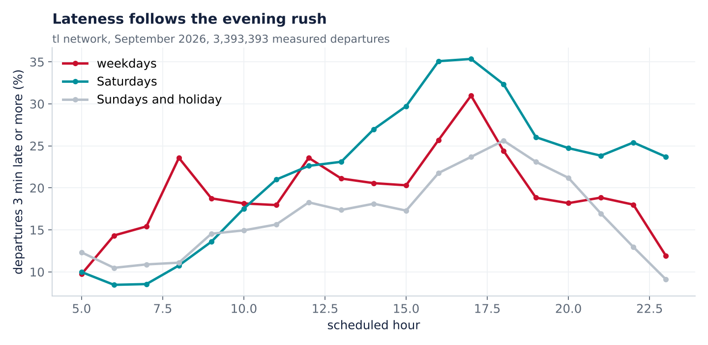</p>

En semaine, la part de départs en retard monte dès 7 h et culmine à la pointe du soir ; le week-end, le réseau reste
bien plus ponctuel. Le lundi du Jeûne fédéral (21 septembre, férié dans le canton de Vaud) est traité comme un
dimanche.

<p align="center">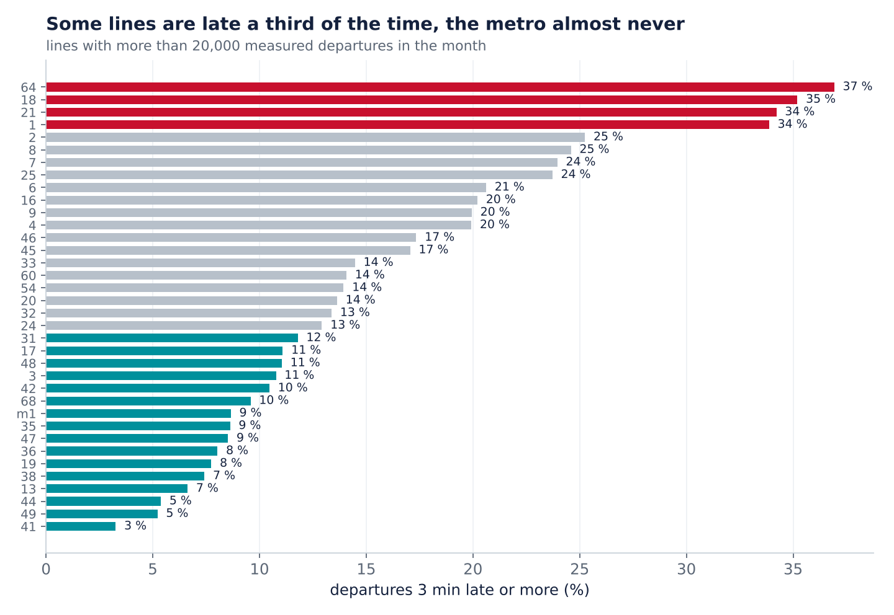</p>

## 2. Localiser : où le retard se crée

<p align="center">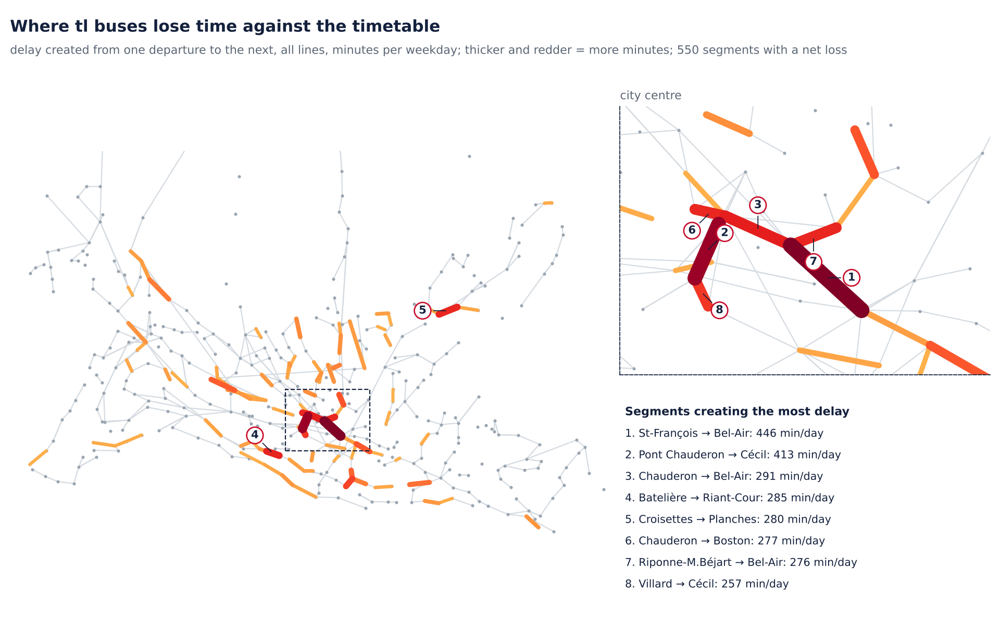</p>

Entre deux arrêts consécutifs, le retard créé est la variation du retard mesuré d'un départ au suivant (trajet et
arrêt), cumulée sur toutes les courses d'un jour de semaine. Les arrêts sont placés grâce à la liste officielle des
points d'arrêt suisses. Les segments du centre (Chauderon, Bel-Air, St-François) concentrent le retard : c'est là
que priorité aux feux, voies réservées ou organisation de la montée rapportent le plus de minutes.

## 3. Régularité des lignes fréquentes

<p align="center">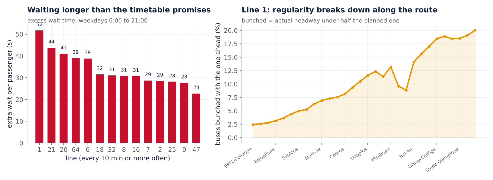</p>

Sur une ligne à un bus toutes les 10 minutes ou mieux, les voyageurs n'ont pas d'horaire en tête : ce qui compte est
l'intervalle. Pour chaque arrêt et chaque sens, les intervalles réels sont comparés aux intervalles prévus.

* **Peloton** : intervalle réel inférieur à la moitié de l'intervalle prévu ; **trou** : plus de 1,5 fois.
* **Attente en plus** (excess wait time) : attente moyenne réelle moins attente promise par l'horaire, pour des
  voyageurs qui arrivent au hasard. Promise : 4,3 min ; réelle : 4,8 min.
* Le profil le long de la ligne montre **où** la régularité se dégrade, donc où placer une régulation à l'intervalle.

## 4. Correspondances aux grands pôles

<p align="center">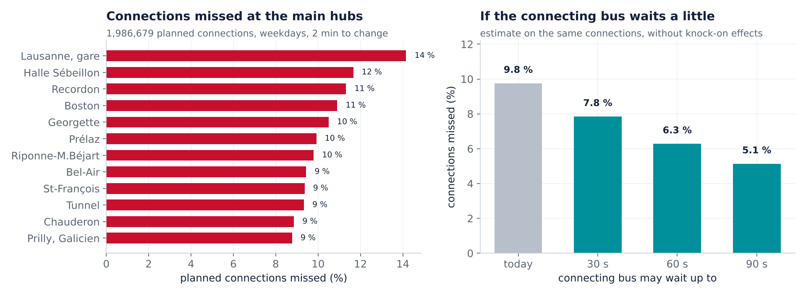</p>

Aux 12 arrêts desservis par le plus de lignes, chaque arrivée est associée au premier départ d'une autre
ligne prévu entre 3 et 10 minutes plus tard. Avec 2 minutes pour changer, la correspondance est manquée si ce bus
part avant le voyageur, qui attend alors le suivant. Le pôle le plus exposé est Lausanne, gare
(14,2 % manquées). Avec 1 minute pour changer, la part manquée serait de
6,3 % ; avec 3 minutes, 14,8 %.

Une attente du bus en correspondance limitée à 30, 60 ou 90 s est simulée sur les mêmes correspondances :
7,8 %, 6,3 % et 5,1 % manquées.
À 60 s, 23 % des départs concernés seraient retenus, 31 s en
moyenne. L'estimation ignore l'effet en chaîne sur les voyageurs déjà à bord : c'est un argument pour un essai sur un
pôle, pas une conclusion.

## 5. Prédire le retard quelques arrêts plus loin

<p align="center">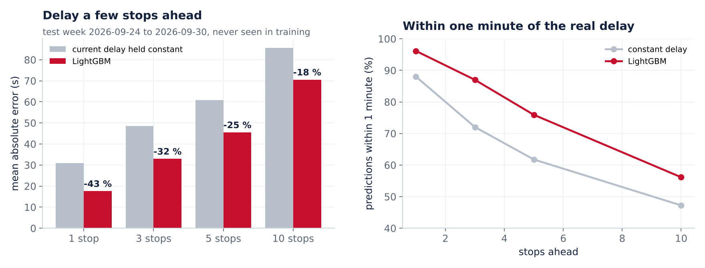</p>

* **Question.** Un bus a 2 minutes de retard à cet arrêt : quel retard aura-t-il 1, 3, 5 ou 10 arrêts plus loin ?
* **Référence.** Garder le retard actuel, ce que font la plupart des affichages.
* **Modèle.** LightGBM sur le changement de retard, avec le retard actuel, sa tendance sur les deux arrêts
  précédents, la ligne, l'arrêt de départ et l'arrêt visé, l'écart horaire prévu, l'heure et le jour.
  3 000 000 paires d'apprentissage tirées des trois premières semaines,
  1 000 000 paires de test sur la dernière semaine.
* **Fourchette.** Deux modèles de quantiles (10 % et 90 %) donnent une fourchette, recalibrée par prédiction conforme
  sur les derniers jours d'apprentissage : sur la semaine de test, le retard réel y tombe dans
  81 % à 80 % des cas selon l'horizon, pour un objectif de 80 %.
* **Simulateur.** Dans le tableau de bord, on choisit une ligne, un arrêt et un retard : la prévision et sa
  fourchette s'affichent pour les dix arrêts suivants.

## 6. Agir sur les horaires

<p align="center">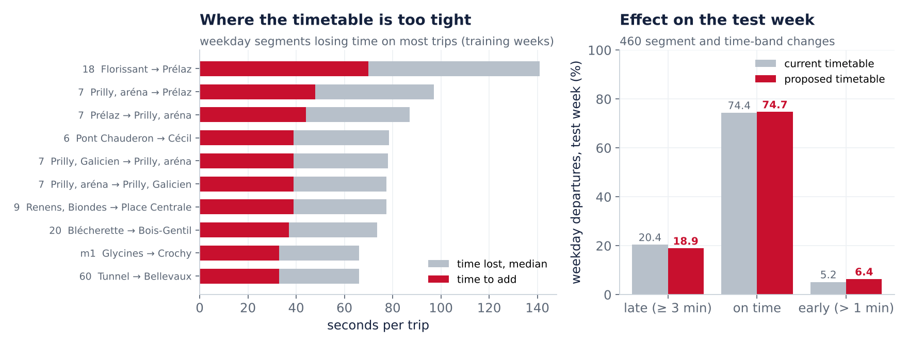</p>

Pour chaque segment entre deux arrêts, le temps de parcours réel est comparé au temps prévu. Quand un bus perd du
temps sur la plupart des courses, à la même tranche horaire, l'horaire est trop serré à cet endroit. Sur les semaines
d'apprentissage, l'outil propose d'y ajouter la moitié du temps perdu médian (90 s au plus) ; il applique ensuite ces
ajustements à la semaine de test et recalcule la ponctualité. Exemple : ligne 18, Florissant → Prélaz,
pm peak, 141 s perdues en médiane sur 106 courses, 70 s proposées.

Les bus sont supposés rouler comme ils l'ont fait ; seul l'horaire qui les juge change. Ajouter seulement la moitié
du temps perdu garde les départs en avance sous contrôle (5,2 % → 6,4 %).

## 7. Une fiche d'actions par ligne

<p align="center">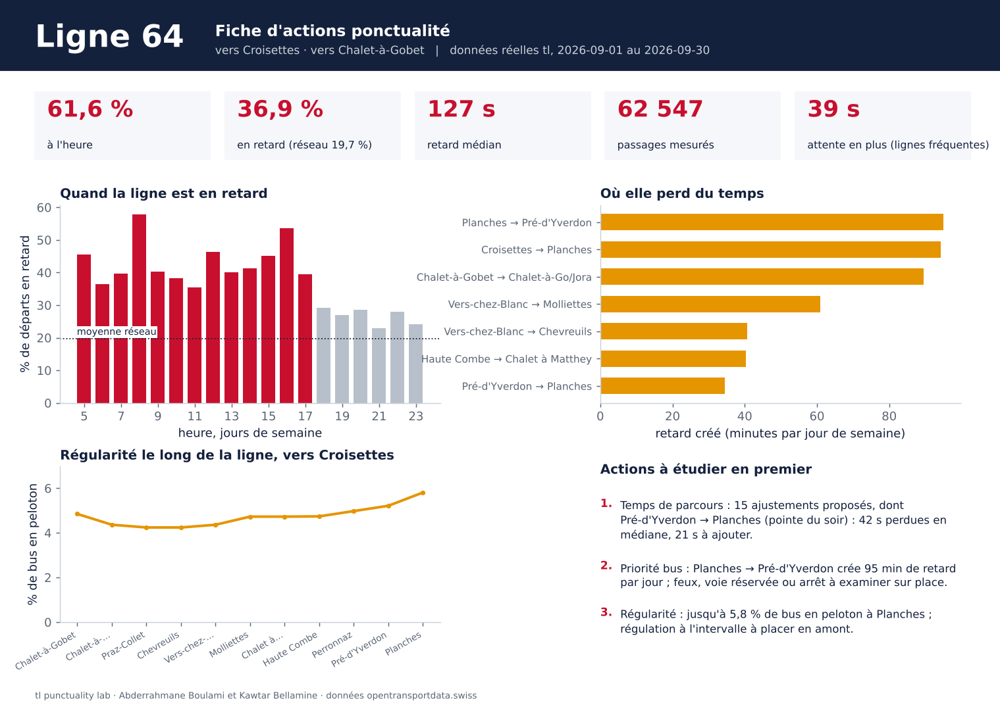</p>

`tools/line_sheets.py` produit, pour chaque ligne, une page qui rassemble ponctualité heure par heure, segments qui
coûtent le plus, régularité le long de la ligne et actions à étudier en premier : [ligne 64](docs/fiches/ligne_64.png) · [ligne 18](docs/fiches/ligne_18.png) · [ligne 21](docs/fiches/ligne_21.png) · [ligne 1](docs/fiches/ligne_1.png) · [ligne 2](docs/fiches/ligne_2.png)
([toutes en PDF](docs/fiches/fiches_lignes.pdf)).

## Tableau de bord

```bash
pip install -r requirements.txt
streamlit run app/dashboard.py
```

Sept onglets en français : réseau, carte du retard, régularité, correspondances, prédiction (avec simulateur),
horaires, fiche ligne.

| Régularité | Simulateur de retard |
|---|---|
| 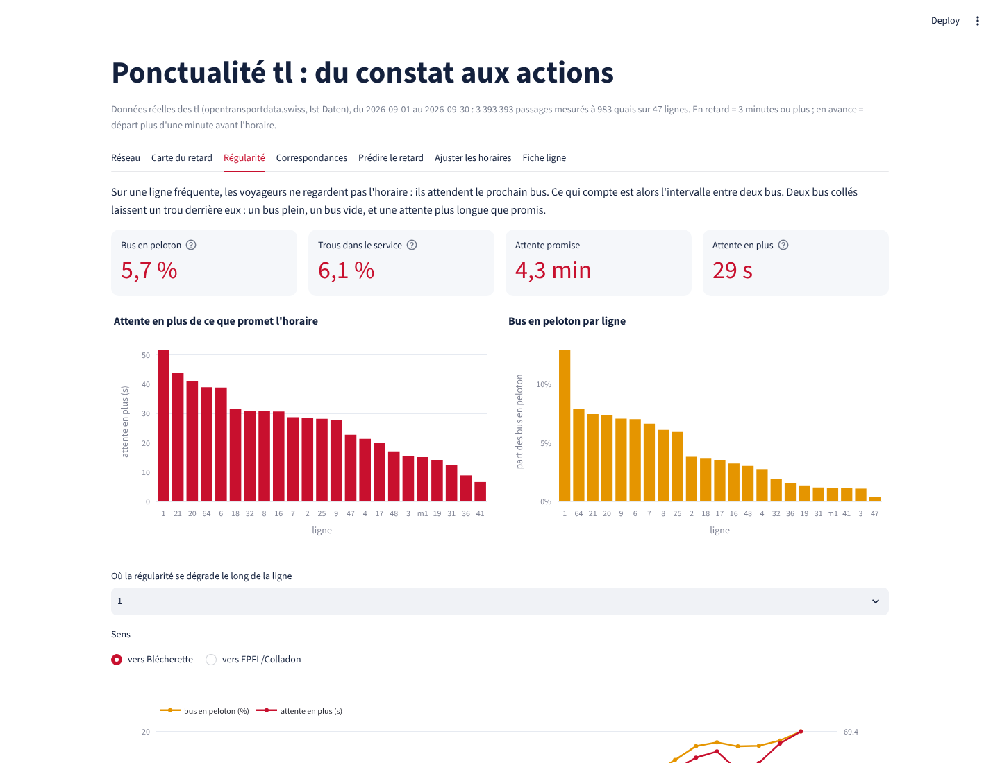 | 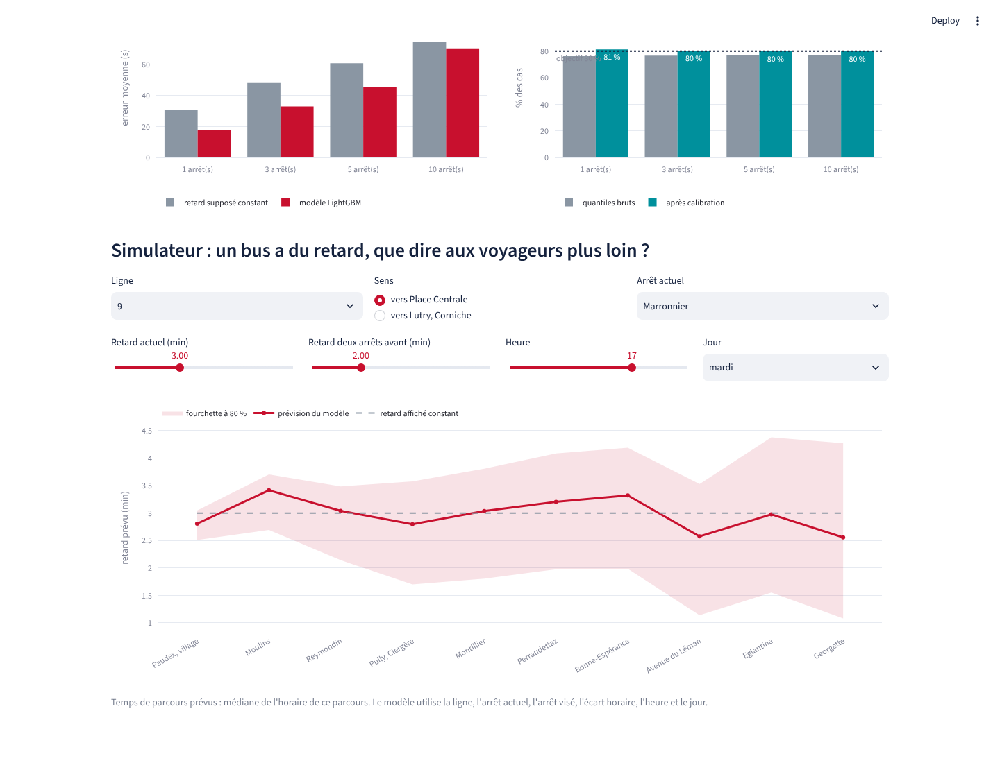 |
| **Correspondances** | **Fiche ligne** |
| 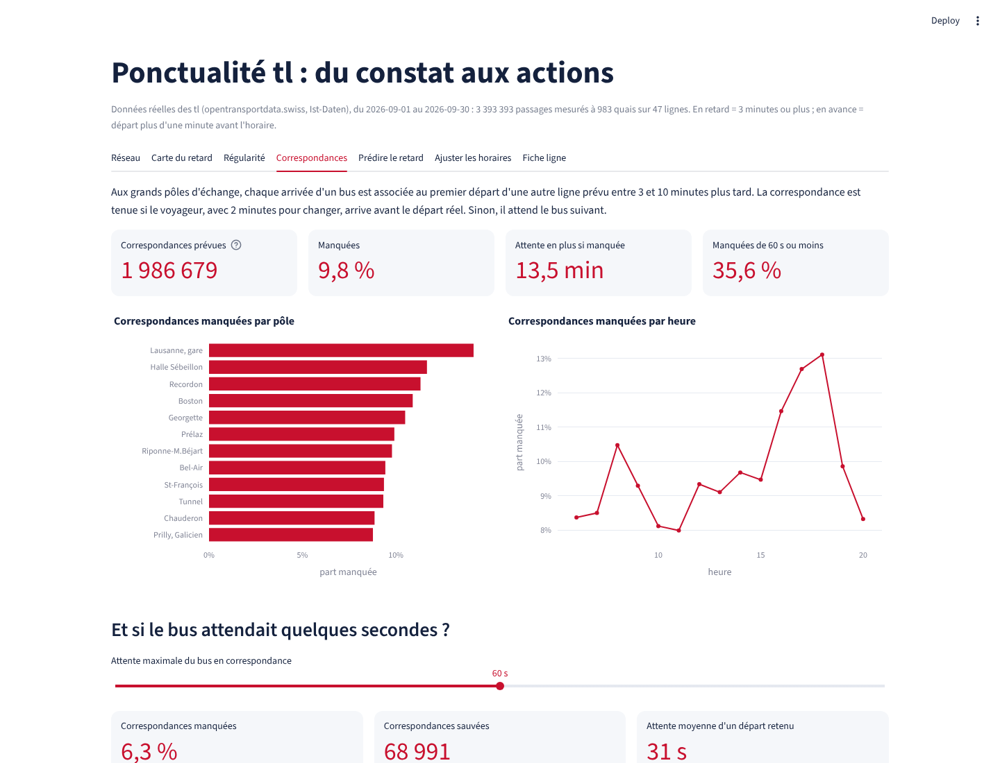 | 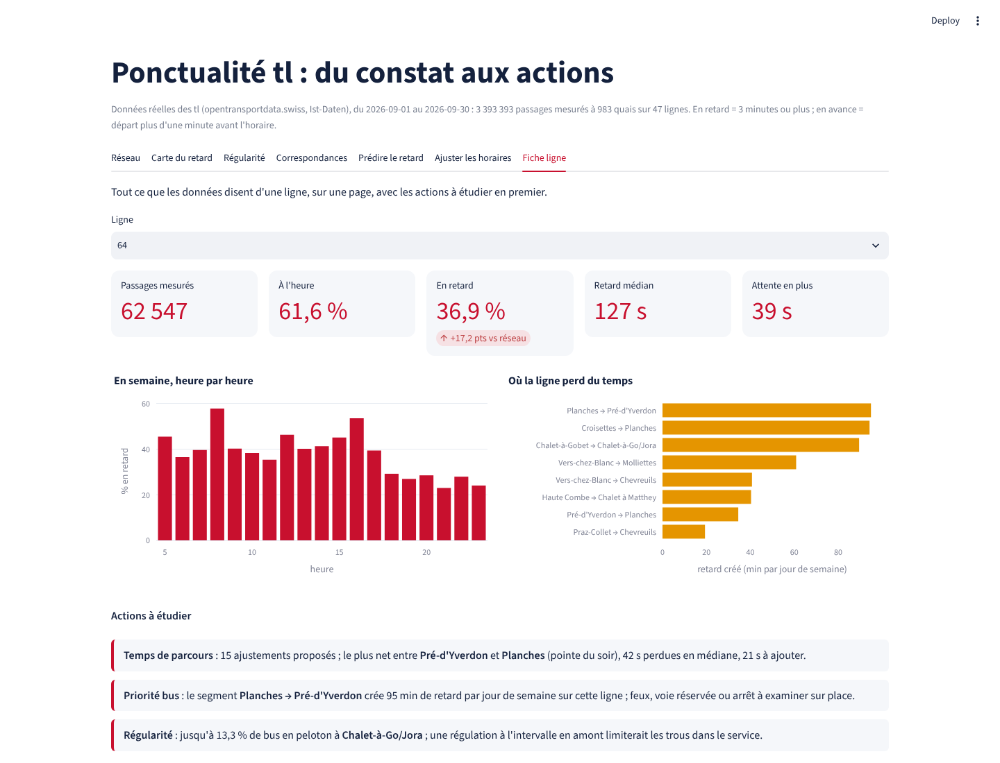 |

## Données

* **Données réelles (Ist-Daten)** d'[opentransportdata.swiss](https://opentransportdata.swiss) : pour chaque course
  de chaque entreprise de transport suisse, l'heure prévue et l'heure réelle (ou la dernière prévision) à chaque
  arrêt. L'archive de septembre 2026 pèse 1,4 Go pour toute la Suisse ; `tools/extract_tl.py` la lit par requêtes
  partielles, décompresse chaque jour à la volée et ne garde que l'opérateur TL, soit environ 123 000 lignes par jour
  ouvré et 39 Mo pour le mois (non versionnés ; deux jours sont inclus dans `data/raw/sample/`).
* **Points d'arrêt** (didok, opentransportdata.swiss, via data.sbb.ch) : coordonnées des 458 arrêts desservis,
  dans `data/raw/tl_stations.csv`.
* Un passage compte s'il est **mesuré** (statut REAL), non supprimé, avec un écart entre -10 et +60 min.
  **En retard** : 3 minutes ou plus, seuil de ponctualité des transports publics suisses. **En avance** : départ plus
  d'une minute avant l'horaire.

## Reproduire

```bash
python tools/extract_tl.py 2026-09         # reconstruit l'extrait depuis l'archive publique (optionnel)
python experiments/run_all.py              # étude complète, environ 13 minutes
python experiments/run_all.py --sample     # deux jours inclus dans le dépôt (CI)
python -m pytest                           # réseaux synthétiques à vérité connue + contrôles sur l'extrait réel
python tools/figures.py && python tools/line_sheets.py && python tools/write_readme.py
```

Les tests construisent des réseaux dont la vérité est connue : un segment lent doit être retrouvé, un service
parfaitement régulier ne doit montrer aucune attente en plus, des bus décalés deux à deux doivent apparaître en
peloton à partir du bon arrêt, une correspondance tenue ou manquée de 30 s doit être classée comme telle.

## Limites et suites

* Un mois de données : la météo, les travaux et les événements ne sont pas encore des variables. Les données de
  MétéoSuisse et les annonces de perturbations sont les prochaines à ajouter.
* La fréquentation n'est pas publique : chaque correspondance et chaque passage comptent autant. Avec les comptages
  des tl, les actions seraient classées par nombre de voyageurs touchés.
* Les effets des horaires et de l'attente en correspondance sont des estimations sans effet en chaîne ; un essai sur
  une ligne ou un pôle pilote est la mesure définitive.

## English summary

Real departure data for every tl bus and metro at every stop in September 2026 (3 507 231 stop events),
turned into operating decisions: punctuality by line and hour (on time 74.3%,
27.7% late in the weekday evening peak), a map of where delay is created
(10 segments out of 550 create 13% of it), headway regularity on frequent lines (29 s excess
wait per passenger), connection reliability at 12 hubs (9.8% missed, 6.3%
with a 60 s hold), delay prediction a few stops ahead with LightGBM (25% lower
error than holding the current delay five stops ahead, on an unseen week, with a conformally calibrated 80% band),
460 running-time adjustments that cut lateness on the test week from 20.4%
to 18.9%, and a one-page action sheet per line.

Data: opentransportdata.swiss (actual data and service points), terms of use of opentransportdata.swiss. Code: MIT.
